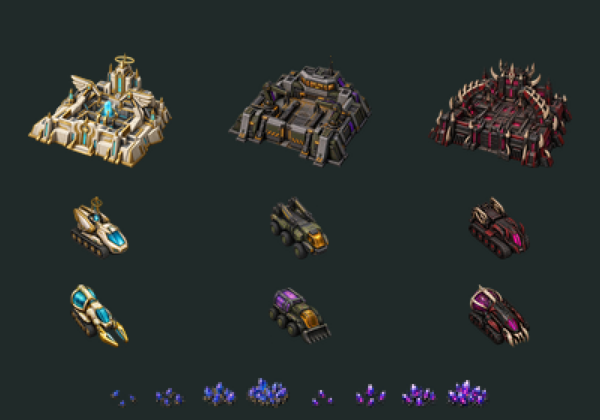

# Construction, logistics and Veilglass artwork

Columns are Angels, Humans and Demons. Rows show Construction Yards, MCVs and
harvesters at 3x nearest-neighbour scale. The bottom shows rough and enriched
Veilglass at four density levels, enlarged 4x.

## Integrated assets

- Three yards: ivory/gold wing gantries; olive/graphite crane workshop;
  black-iron/bone forge gantries. Each has a 128x128 transparent frame.
- Three MCVs and three collectors: each source contains eight distinct directional
  views, packed into eight 64x64 frames. Source order is N, NE, E, SE, S, SW, W, NW.
  OpenRA uses the reverse yaw convention, so sequences specify `Facings: -8`.
- Nine 56x42 build/editor icons. The existing game still starts with an MCV;
  this art pass does not unlock additional MCV production.
- Rough blue-violet Veilglass with gold inclusions and brighter enriched Veilglass
  with pink/red inclusions. Each grade has four 24x24 density frames. Both retain
  the original resource indices, values, harvesting permissions and map quantities.
- Yards, MCVs and provisional wrecks select images through all nine faction IDs.
  Harvesters override `ImageByFullness` so loading cargo cannot restore the RA truck.
  Cargo pips remain the indication of load; the collection vessel artwork is static.
- Player-colour ownership markers on all new active actors. True-colour PNG pixels
  themselves are not recoloured by OpenRA's indexed player palette.

## Rebuild and source

Run `npm run art` with the pinned Sharp dependency installed. The logistics script
slices connected vehicle silhouettes to avoid clipping collectors at the nominal
source grid boundaries, then resizes and packs them. Resource strips use a common
crop and scale to preserve their increasing density. OpenRA's standard `FrameSize`
and `FrameAmount` tEXt metadata is embedded in each sheet with valid PNG CRCs.
The game consumes committed PNGs and does not require Node.

The eleven new sources are in `source/`. They were generated with the built-in
OpenAI image tool, not drawn by the packing script. Exact prompts are in
`logistics-prompts.json`; hashes are in `sources.json`. No third-party reference
artwork was used. One Angel MCV diagonal was corrected using the generated sheet
as an edit target before integration.

## Validation and remaining work

- OpenRA YAML validation: mod and both maps pass without warnings.
- Missing-sprite check: all four inherited tilesets pass with local content installed.
- Six Python tests pass, including sheet dimensions, metadata, every PNG chunk CRC,
  and source provenance hashes.
- Visually inspected all high-resolution sources and the packed preview.
- Live menu rendered all three yards, three MCVs, three collectors and both resource
  grades successfully; collectors were observed moving at the deposits.
- Deploy/undeploy actor identities and offsets, yard production, harvester storage,
  docking and resource rules are preserved. Full deployment/capture/harvesting cycles
  for all nine subfactions have not been playtested in this pass.

This is a directional/static art pass. No animated tracks, working gathering tools,
cargo-fill artwork, yard construction sequence or dedicated damaged/wreck drawings
are included. Harvest and docking sequences use the appropriate facing's static
frame, retaining animation completion callbacks needed by the gameplay code.
Provisional vehicle husks use the new silhouettes with existing darkening/fire;
dedicated wreck silhouettes and capture/recovery visuals need a later pass.
