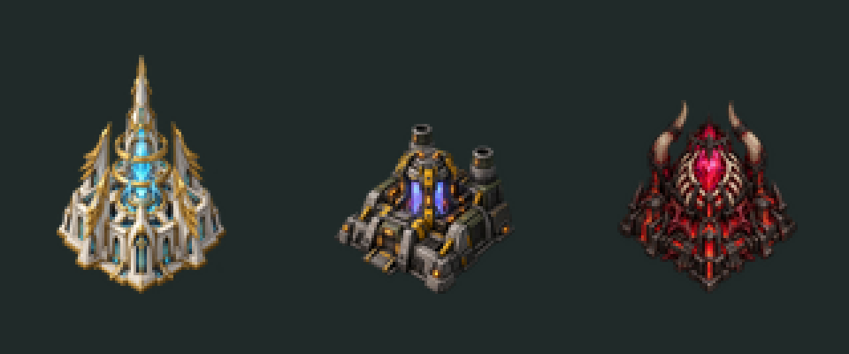
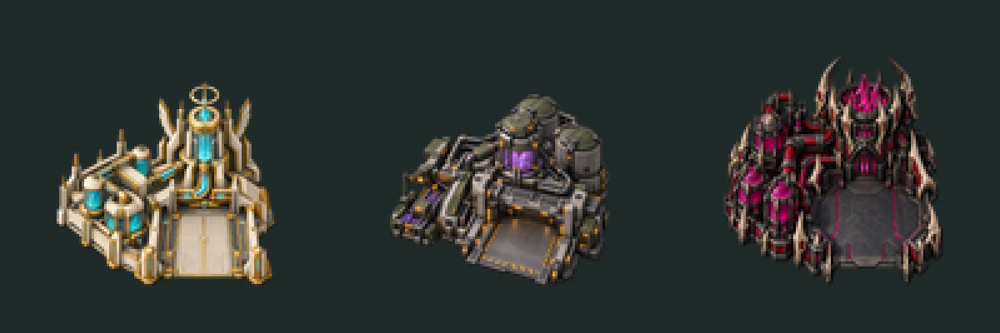

# Sevenfall faction art — power and refinery passes



Left to right: **Radiant Spire** (Angels), **Veil Generator** (Humans),
**Furnace Heart** (Demons). The high-resolution source PNGs are in `source/`.

## Implemented

- Three original, transparent power-building sprites and matching 56×42 production icons.
- Three original refinery sprites with open unloading aprons and matching 56×42 icons.
  Their 128×128 frames contain artwork up to 88×96 pixels. Existing footprints,
  docking offsets, free harvesters, storage, costs and power use are preserved.
- Three parent faction emblems, mapped to all nine subfaction selectors.
- Sevenfall menu/loading graphic with the three emblems and game title, replacing the RA logo.
- 1×, 2× and 3× UI atlases, padded to power-of-two GPU texture dimensions.
- PNG sequence loader registration and actor sequence bindings. Each building has an
  always-visible player-coloured `===` ownership marker; PNG pixels themselves are not remapped.
- Main-menu showcase contains all six structures. Only the showcase suppresses free
  harvesters, so placeholder vehicles do not clutter the resource-free menu.



Left to right: Angel, Human and Demon Veilworks. These designs share an open front
unloading apron, with faction-specific processing towers and materials.

## Art direction

| Faction | Architecture | Materials / palette |
|---|---|---|
| Celestial Host | Tall crystal spire, halo rings, wing buttresses | Ivory, gold, cyan |
| Last Dominion | Armoured compact reactor, cooling stacks, conduits | Graphite concrete, olive steel, amber |
| Infernal Legions | Horned living furnace, rib cage, crystal heart | Black iron, scorched bone, crimson, magenta |

## Provenance

The nine source PNGs were generated for Sevenfall using the built-in OpenAI image
generation tool on 21 October 2026. Prompts described original faction concepts from
the design bible; no third-party reference artwork was supplied. File provenance and
SHA-256 hashes are recorded in `sources.json`. These are AI-generated development assets,
not hand-painted work. The repository's original-content licensing decision remains open;
this pass does not assign a new content licence or claim exclusive rights.
The exact refinery generation prompts are recorded in `refinery-prompts.json`.

The script performs technical resizing and atlas packing, preserving source transparency.
It adds ordinary text for the title and random-faction question mark. Existing Red Alert
terrain, units, other structures, interface borders and audio remain placeholders.

## Rebuild derived assets

The game consumes committed PNGs, so Node is **not** needed to build or play it.
To regenerate the derived artwork, use Node 20.9+ and install the exact `sharp` version
from the root `package.json`, then run:

```sh
npm install
npm run art
python scripts/build.py test
python -m unittest discover -s tests
```

The title uses Georgia/sans-serif fonts resolved by the host; exact typography may vary
when rebuilding on another OS. Inspect the result before committing regenerated atlases.

## Deliberate limitations

This is a static sprite pass. Idle, damaged-idle and make currently use the same image.
There is no custom construction animation, damaged artwork or wreck sprite yet; inherited
power-building and refinery bib/death art is removed. The inherited refinery roof overlay
is removed because the new art has an open dock; there is no separate foreground
occlusion layer yet. Docking alignment and occlusion need a full harvesting playtest.
Gameplay costs, output and prerequisites are unchanged.
The nine subfactions share their parent's emblem; distinct subfaction heraldry is still pending.

## Verification

- OpenRA `--check-yaml` passes for the mod and both maps.
- OpenRA `--check-missing-sprites` passes for all four inherited tilesets with local content installed.
- Five regression tests pass, including PNG dimensions/alpha, texture sizes and flag-region bounds.
- All three building PNGs and the new menu graphic were visually inspected in the running engine.
- Observed the Angel spire, production icon and player-colour marker in a live skirmish.
- High-DPI atlas files are checked structurally; 2×/3× display hardware has not been playtested.

Refinery pass validation: YAML checks pass for both maps, missing-sprite checks pass
for all four tilesets, and the five regression tests include refinery frame dimensions
and transparency. Derived sprites were visually inspected and the updated game
launched successfully; the Angel refinery icon was observed in the live sidebar.
All-faction harvesting and damage-state playtests remain outstanding.

Next art pass: harvester designs for each parent faction, then infantry;
add construction/damage animations and team-colour masks as the animation pipeline develops.
